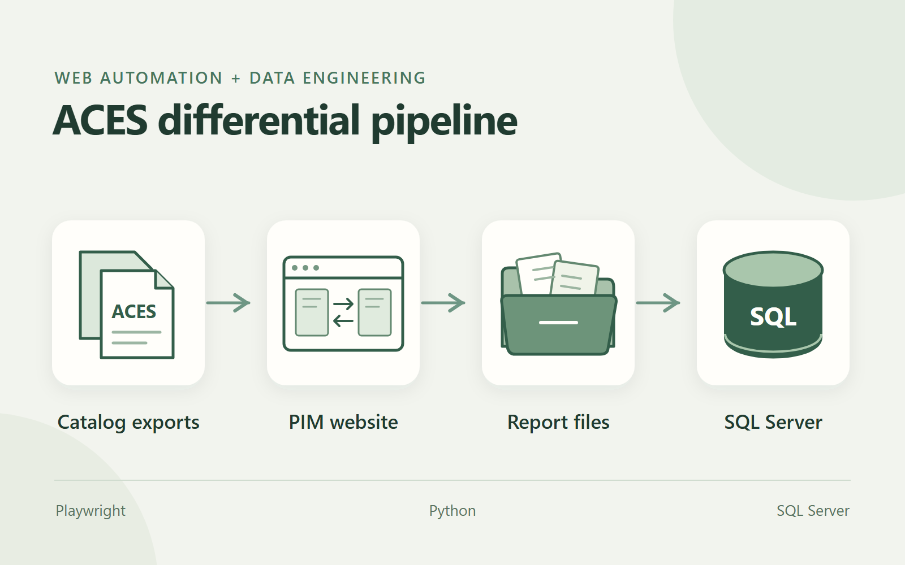

# ACES Differential Automation

**An automated data pipeline connecting the PIM website, report files, and SQL Server.**

I built this pipeline to combine web automation and data engineering: discover ACES exports, submit catalog comparisons through a product information management (PIM) website, collect completed reports, and deliver analysis-ready data in SQL Server.

The workflow coordinates a browser session, asynchronous PIM processing, network files, SQL transactions, and email notifications. Each can fail independently. The pipeline records progress at each boundary, distinguishes safe retries from uncertain submissions, and recovers completed work without repeating it.

**Status:** Deployed internally on Windows. **Built with:** Python · Playwright · SQL Server · Windows Task Scheduler · Outlook.



*Illustration of the implemented workflow, not a screenshot or a simulated production run.*

This repository contains **sanitized original source and executable tests**. It does not include company catalogs, licensed vehicle reference data, credentials, internal endpoints, or a working connection to the company's PIM system.

## The catalog problem, in plain language

An automotive parts catalog describes which vehicles a part applies to, often with additional conditions such as engine, region, installation position, quantity, or notes. One part can therefore have many application records.

ACES—the Aftermarket Catalog Exchange Standard—is used to exchange product fitment information. It provides a common structure for communicating those relationships; it does not determine whether a part physically fits a vehicle. [Auto Care Association](https://www.autocare.org/about-us/frequently-asked-questions)

In this workflow, recurring full exports are generated for multiple catalog keywords. Comparing a newer export with its predecessor reveals changes in applications, parts, and notes. The operational challenge is carrying each comparison through several systems: choose the right pair, submit it, wait for PIM, locate the resulting files, organize them, and append their records to the right SQL tables without importing the same report twice.

The deployed configuration follows 16 catalog keywords. The business cadence is monthly; the hourly schedule checks for arrivals and unfinished work. It does not generate a new comparison every hour. Each comparison keeps its own period folder and report identity, so later months append to the history instead of replacing earlier results.

The Python pipeline coordinates those steps. **PIM performs the differential calculation.** The pipeline does not implement the comparison algorithm, certify the catalog changes, or perform the subsequent business analysis. Its endpoint is a verified, traceable import into SQL Server.

[Business workflow and a worked example](docs/business-workflow.md)

## A typical report lifecycle

1. **Discover and pair exports.** Match the configured keyword and export filename, then choose the previous/current pair using generation date and modification time. Existing saved pairs remain fixed. Ambiguous ties require review.
2. **Submit to PIM.** Upload both ZIPs, select the exact uploaded filenames, and enter the deterministic report name. Record success only after observing the matching acceptance message.
3. **Wait for the result set.** PIM produces two ZIPs and two `.error` files. The collector waits for complete, stable outputs and checks that they belong to one report instance.
4. **Collect and extract.** Preserve the four originals in a keyword/comparison-date folder. Extract each ZIP into a directory with its original ZIP basename.
5. **Validate and import.** Validate all eight TSVs, preserve text values, populate report metadata, and commit the report's records and import-log entries in one SQL transaction.
6. **Notify the right audience.** Submission and SQL-completion messages go to the configured success list. Failures, uncertain submissions, reminders, and recoveries go to the workflow owner.

An hourly run processes the stages sequentially. A report submitted during one run can be collected in a later run when PIM finishes. The system does not wait in a loop for PIM to produce outputs.

## What reaches SQL Server

| PIM TSV output | Destination | Purpose in this pipeline |
| --- | --- | --- |
| AddedApps | `dbo.Differential_ACES_AddedApps` | Retain application additions reported by PIM |
| DeletedApps | `dbo.Differential_ACES_DeletedApps` | Retain application deletions reported by PIM |
| AddedParts | `dbo.Differential_ACES_AddedParts` | Retain added-part records |
| DeletedParts | `dbo.Differential_ACES_DeletedParts` | Retain deleted-part records |
| AllParts | `dbo.Differential_ACES_AllParts` | Retain PIM's all-parts output |
| AnalysisParts | `dbo.Differential_ACES_AnalysisParts` | Retain PIM's part-level comparison output |
| UniqueNotes | `dbo.Differential_ACES_UniqueNotes` | Retain the exported unique-note records |
| VCDBNotes | `dbo.Differential_ACES_VCDBNotes` | Retain the exported VCdb-note records |

These are this PIM tool's output categories, not eight file types prescribed by the ACES standard. The importer preserves their approved headers and validates their order. It does not reinterpret their business meaning.

Every row carries a `Meta_` prefix for added identifiers: report UUID, keyword, export dates, source filename, source row number, and Eastern import timestamp with UTC offset. A `BIGINT` identity provides a database row key. The tables remain self-contained, so a result can be traced back without first joining a report register.

The separate import log records the successful file imports, including zero-row TSVs. It is the authority for duplicate detection and completed-import notifications. [Schema and data contracts](docs/data-contracts.md)

## Engineering decisions that matter

- **Automate a stateful website.** Playwright logs in, uploads two exports, waits for the exact files to become selectable, triggers the report-name field's UI events, and checks a fresh matching acceptance message. Browser failures are isolated so a later pair can start with a recovered browser session.
- **Treat acceptance uncertainty differently from failure.** If the browser loses the confirmation after Compare may have been clicked, automatically resubmitting could create duplicate PIM work. That report remains `NeedsReview` instead.
- **Commit one report together.** All eight imports and their log entries share a SQL transaction. A lost commit response is resolved from the durable SQL log on a later run, not by guessing whether the first attempt failed.
- **Keep orchestration simple.** One controller prevents overlapping runs and gives each stage a timeout. SQL application locks and uniqueness constraints protect the database independently of the local tracker.
- **Avoid rereading finished work.** Unchanged exports skip stability waits and ZIP reads. Completed reports are checked against one import-log snapshot; their TSVs are not reopened and an unchanged tracker is not rewritten.
- **Persist notification work.** Failed email sends remain queued. Identical unresolved issues are summarized daily rather than emailed every hour. Sending an email again never requires reimporting a report.

[Architecture and recovery behavior](docs/architecture.md)

## Evidence from the deployed workflow

At the recorded validation checkpoint, SQL contained **10 completed reports, 80 file-import records, and 1,613,045 data rows**. Those are imported report records, not unique parts, vehicles, or newly approved catalog applications.

In one before/after idle-run comparison, discovery fell from **9.46 to 2.75 seconds**, completed-import checks from **3.12 to 1.27 seconds**, and the full run from roughly **15 to 7 seconds**. The tracker was not rewritten and SQL row counts did not change. This is a single operational observation, not a guaranteed runtime or an estimate of employee time saved.

The published source passes **113 offline tests** covering export pairing, safe retries, transaction recovery, duplicate protection, file publication, notification routing, and process containment. The tests exercise actual implementation modules with synthetic temporary fixtures and mocked external services. They do not submit to a real PIM site or import into production SQL. [Validation and limitations](docs/verification.md)

## Inspect and test the source

| Start here | What it demonstrates |
| --- | --- |
| [Workflow controller](src/workflow_runner.py) | Sequential stages, overlap protection, subprocess limits, console progress |
| [Export detector](src/detector.py) | Stable identity, predecessor selection, incremental checks and atomic tracker saves |
| [PIM submission](src/pim_automation.py) | Exact file selection, durable uncertainty state and confirmation checks |
| [Collector](src/collect_reports.py) | Stable four-file sets, ZIP checks, safe extraction and partial-work recovery |
| [SQL importer](src/import_reports.py) | Typed validation, ledger-first skips, transactions and duplicate guards |
| [Owner notifications](src/workflow_alerts.py) | Persistent outbox, issue reminders and recovery messages |
| [SQL completion emails](src/sql_success_emails.py) | Committed-log evidence, per-file row counts and HTML output |

On Windows with Python 3.12 or later:

```powershell
py -3.12 -m venv .venv
.\.venv\Scripts\python.exe -m pip install -r requirements.txt
.\.venv\Scripts\python.exe -m playwright install chromium
$env:PYTHONPATH = "$pwd/src"
.\.venv\Scripts\python.exe -m unittest discover -s tests -v
```

The browser tests use a local HTML fixture. A real browser download is required for those tests, but company access, Outlook, and a running SQL Server are not. Windows is required for the process-containment tests. [CI](https://github.com/Kuvelet/ACES-Differential-Automation/actions/workflows/tests.yml)

Full operation needs an authorized PIM environment, its output contract, a configured Windows user, network folders, SQL Server, and Outlook. The public example is disabled and is not a ready-to-run company deployment. [Configuration and reconstruction](docs/reconstruction.md) · [Sanitization record](docs/sanitization.md)

## My contribution

I defined and developed the workflow from the catalog operations problem through deployment: export pairing rules, PIM submission behavior, folder structure, SQL metadata and types, duplicate prevention, failure handling, and stakeholder notifications. I used AI coding assistance while directing implementation, reviewing tradeoffs, and testing the behavior against the actual workflow.

The result is a repeatable path from recurring catalog snapshots to SQL history. The remaining operational boundary is explicit: uncertain PIM submissions can still need human review, and detecting a computer that never starts requires monitoring outside that computer.

Built by [Can Kuvelet](https://kuvelet.github.io/portfolio/).
