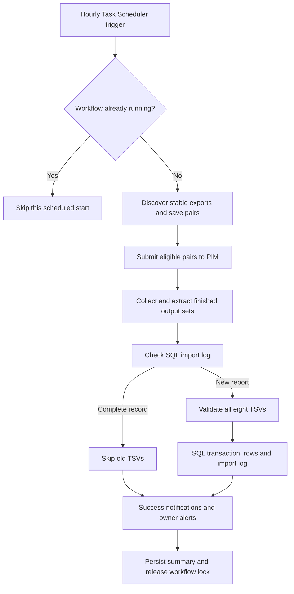

# Architecture and recovery

The pipeline operates across files, a browser, SQL Server and Outlook. There is no single transaction across those systems. Durable states and conservative retries connect the stages.

## State and identity

The CSV tracker records the source UUID, keyword, generation date, modification time, saved predecessor, submission result, collection result, and SQL import result. The report name contains the keyword and comparison dates. Once a pair is saved, later discoveries do not silently change its predecessor.

Generation date and modification time determine ordering within a keyword. Same-order ties are ambiguous. Discovery inventories files currently present; it does not choose a missing predecessor from a stale tracker snapshot. If a new or changed export appears, that keyword's candidates receive stability and ZIP checks before pairing. Existing submission inputs are checked again immediately before browser work.

`Succeeded` in the submission column means **accepted by PIM**, not processed by PIM or imported into SQL. Collection has its own state; SQL import has its own state.

## Submission uncertainty

Before the external Compare click, the script durably saves `NeedsReview`. A matching fresh acceptance popup changes it to `Succeeded`. A handled failure before crossing that boundary becomes `Failed` and can retry later. An interrupted `Running` row is conservatively converted to `NeedsReview`. Invalid input can also require review.

There is no verified PIM task-history lookup in this implementation. Missing output files do not prove that a submission failed. The pipeline therefore does not blindly retry uncertain submissions or automatically promote them based on guessed acceptance.

## Files and transactions

The collector groups outputs by exact report name and numeric PIM prefix. It waits for the expected two ZIPs and two error files, rejects conflicting sets, checks source stability and hashes, validates extraction paths, and preserves conflicting existing content for review. A `.error` filename is part of the PIM output contract; its presence alone is not an automation failure. The pipeline does not infer business approval from its contents.

Each report's SQL imports use one explicit transaction on an autocommit connection. An exclusive transaction-owned SQL application lock serializes imports. Unique `(Meta_ReportID, Meta_SourceRowNumber)` constraints and import-log keys provide additional protection. Insert batches use parameterized `OPENJSON` with explicit SQL types; all eight files are prepared before insertion begins.

If a transaction fails, uncommitted changes roll back. If the connection is lost after commit but before acknowledgement, the next run consults the log. The bulk precheck is only an optimization: a new import rechecks the database inside the transaction, under the SQL lock. It does not trust an earlier snapshot to authorize duplicate inserts.

The tracker is saved with flush/fsync and atomic replacement, retaining the previous snapshot. SQL completion is authoritative if a tracker save fails after a committed import. Restoration from backup is deliberate; automatically using an older tracker could requeue a PIM submission.

## Scheduling and process lifetime

One Windows task runs hourly on the hour. Scheduler overlap prevention is complemented by a local workflow lock. Stages also use the existing tracker lock to protect against standalone scripts. A new scheduled occurrence is skipped if the current workflow is still active; queued work is not discarded.

Each stage runs in a Windows job object. The child waits for a containment handshake before performing work. A controller exit closes the job handle, terminating owned child processes. Stage timeouts bound file, browser, SQL and email work; SQL rollback may continue server-side after a local termination.

Independent stages can continue after a report-level or stage failure. Unsafe tracker state stops processing. A stalled or broken controller cannot always notify its owner, particularly when local alert storage is unavailable.

## Notifications

| Event | Audience and behavior |
| --- | --- |
| PIM submission accepted | Success list; report and saved input paths |
| SQL import committed | Success list; full report name, filenames, destination tables, per-file counts and total |
| New failure or review issue | Owner only |
| Unchanged unresolved issue | First run at/after 09:00 Eastern, once per day |
| Recovery | Owner only |

Success subjects follow `event | project | full report name`. Email state is independent of import state. The outboxes persist before send; a failed send retries later. They provide **at-least-once handoff**, not exactly-once delivery: if Outlook accepts a message and the process stops before recording that fact, a later run can send it again. Outlook acceptance is not proof of inbox delivery.

The SQL notification state is explicitly initialized to avoid sending historical reports on first enablement. Missing state fails closed instead of silently rebuilding and resending history.

## Scaling and deliberate limits

Idle discovery still lists the directory and reads metadata. Completed imports use a small log snapshot, but the snapshot and tracker grow with history. This is reduced work, not constant-time processing. Reports already imported are treated as final; the pipeline does not audit later TSV edits or direct manual SQL edits.

Current limitations include Windows/user-session dependence, browser selectors tied to an external UI, no automatic resolution of uncertain PIM acceptance, no independent offline-host monitor, and no automatic log retention. Those are operational boundaries, not features claimed by the public case study.
