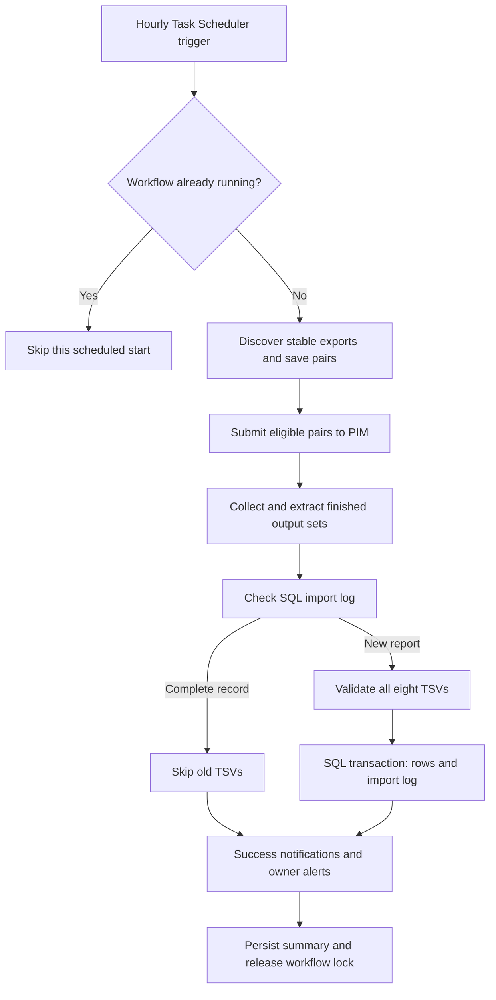

# Architecture and recovery

The hourly controller coordinates files, the PIM website, SQL Server, and Outlook. Each stage saves its progress so a later run can continue unfinished work. SQL imports have their own transaction; the tracker and notification files record work outside the database.

## Tracking reports and submissions

The CSV tracker records the source UUID, keyword, generation date, modification time, saved predecessor, submission result, collection result, and SQL import result. The report name contains the keyword and comparison dates. Once a pair is saved, its predecessor stays fixed.

Generation date and modification time determine the order of exports within a keyword. Ties require review. Discovery chooses from files currently present, so an old tracker entry cannot supply a predecessor that has since disappeared. When a new or changed export appears, the candidates for that keyword receive stability and ZIP checks before pairing. Saved inputs are checked again before submission.

`Succeeded` in the submission column means **accepted by PIM**, not processed by PIM or imported into SQL. Collection has its own state; SQL import has its own state.

Before clicking Compare, the script saves `NeedsReview` to the tracker. A fresh acceptance message matching the report changes it to `Succeeded`. A handled failure before clicking Compare becomes `Failed` and can retry later. If a run is interrupted with a row still marked `Running`, the next run changes it to `NeedsReview`. Invalid inputs can also be held for review.

The implementation has no verified PIM task-history lookup. If confirmation is lost, the owner must check whether PIM accepted the job before releasing it for another attempt. Missing output files alone cannot settle that question.

## Collection and SQL imports

The collector groups outputs by exact report name and numeric PIM prefix. It waits for the expected two ZIPs and two error files, rejects conflicting sets, checks source stability and hashes, validates extraction paths, and preserves conflicting existing content for review. The `.error` files are expected outputs and are retained with the report. Their presence alone does not indicate an automation failure; reviewing their contents is separate from collection.

Each report's SQL imports use one explicit transaction on an autocommit connection. An exclusive transaction-owned SQL application lock serializes imports. Unique `(Meta_ReportID, Meta_SourceRowNumber)` constraints and import-log keys provide additional protection. Insert batches use parameterized `OPENJSON` with explicit SQL types; all eight files are prepared before insertion begins.

If a transaction fails, uncommitted changes roll back. If the connection is lost after commit but before acknowledgement, the next run consults the log. The initial bulk check reduces repeated database reads. Before inserting a new report, the importer checks the log again inside the transaction while holding the SQL lock.

The tracker is saved with flush/fsync and atomic replacement, retaining the previous snapshot. If SQL commits but saving the tracker fails, the next run recovers the import result from the database log. Restoring an older tracker requires review because it could otherwise queue a PIM submission that already happened.

## Scheduling and process control

One Windows task runs hourly on the hour. Scheduler overlap prevention is complemented by a local workflow lock. Stages also use the existing tracker lock to protect against standalone scripts. A new scheduled occurrence is skipped if the current workflow is still active; queued work is not discarded.

Each stage runs in a Windows job object, which groups the child processes so they can be stopped together. The child waits for the controller to confirm that setup before starting work. If the controller exits, closing the job handle terminates its child processes. Stage timeouts bound file, browser, SQL and email work; SQL rollback may continue server-side after a local termination.

Independent stages can continue after a report or stage fails, but unsafe tracker state stops processing. A stalled controller or unavailable alert storage can also prevent owner notifications.

Routine checks still list the export directory and read file metadata. The tracker and import-log snapshot grow over time, even though completed TSVs are skipped. Imported reports are treated as final; later manual changes to their files or SQL rows are not audited.

Operation depends on the Windows user session, network access, and PIM page structure. Browser selectors may need maintenance when the website changes. Monitoring a host that never starts and rotating logs require separate arrangements.

## Email notifications

| Event | Audience and behavior |
| --- | --- |
| PIM submission accepted | Success list; report and saved input paths |
| SQL import committed | Success list; full report name, filenames, destination tables, per-file counts and total |
| New failure or review issue | Owner only |
| Unchanged unresolved issue | First run at/after 09:00 Eastern, once per day |
| Recovery | Owner only |

Success subjects follow `event | project | full report name`. Pending emails are saved before sending and tracked separately from imports. Failed sends retry later. If Outlook accepts a message but the process stops before saving that result, a later run can send it again. Outlook acceptance also does not confirm delivery to the recipient's inbox.

SQL notification state is initialized before enabling emails so historical imports do not trigger new success messages. If that state is missing later, notification processing stops rather than resending the history.
